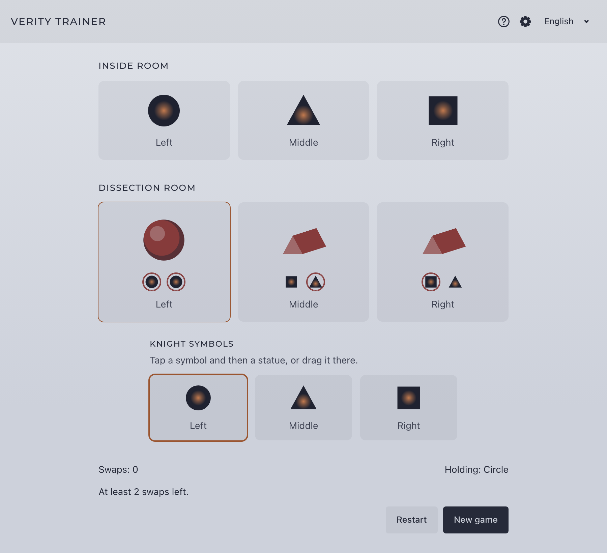

# Verity Trainer

[](https://github.com/unvoid/verity-trainer/actions/workflows/ci.yml)
[](LICENSE)

[English](README.md) · **Español**

Herramienta para practicar los intercambios de símbolos de **Verity**, el cuarto encuentro de la raid *Filo de la Salvación* de Destiny 2.

**Web:** https://verity-trainer-eight.vercel.app/



## Funcionalidades

- **Puntos de partida aleatorios** que cumplen las reglas del encuentro.
- **Recrea tu partida:** elige los callouts de la sala interior y las formas de las estatuas que estás viendo en el juego.
- **Toca o arrastra** los símbolos hasta las estatuas; también se puede jugar con teclado.
- **Solución más corta:** una búsqueda en anchura calcula el mínimo de intercambios y muestra la secuencia óptima al terminar.
- **Pistas:** símbolos de cada estatua, choques con su callout, estatuas válidas y mínimo pendiente.
- **Manual de uso** integrado en la web.
- **Español e inglés.**
- El modo desafío y los símbolos por rondas están implementados tras interruptores de funcionalidades.

## Instalación

Requisitos: **Node.js 26** o superior y **npm 11** o superior (ver `.node-version`).

```sh
git clone https://github.com/unvoid/verity-trainer.git
cd verity-trainer
npm install
npm run dev
```

El `.npmrc` del proyecto fija el registro público de npm y activa `engine-strict`: con una versión de Node anterior, la instalación falla desde el principio.

## Scripts

| Comando | Qué hace |
|---|---|
| `npm run dev` | Servidor de desarrollo |
| `npm run build` | Build de producción en `dist/` |
| `npm run preview` | Sirve el build en local |
| `npm run check` | Comprobación de tipos (Svelte y TypeScript) |
| `npm test` | Ejecuta los tests una vez |
| `npm run test:watch` | Tests en modo observación |

## Funcionalidades por versión

Se activan o desactivan al compilar con variables de entorno (ver `.env.example`):

```sh
VITE_FEATURE_HINTS=true
VITE_FEATURE_CHALLENGE_MODE=false
VITE_FEATURE_SYMBOL_ROUNDS=false
VITE_SITE_URL=https://verity-trainer-eight.vercel.app
VITE_REPO_URL=https://github.com/unvoid/verity-trainer
```

Una funcionalidad desactivada no aparece en la interfaz y se muestra como "Próximamente" en el manual de uso. `VITE_REPO_URL` muestra un enlace a GitHub en la cabecera; déjala vacía para ocultarlo.

## Tecnología

- [Svelte 5](https://svelte.dev/) + TypeScript, con [Vite](https://vite.dev/)
- [Vitest](https://vitest.dev/) para la lógica del dominio, los stores y el i18n
- Formas dibujadas en SVG, sin librerías 3D ni de interfaz
- [Montserrat](https://fonts.google.com/specimen/Montserrat) (SIL Open Font License), alojada con el proyecto mediante `@fontsource-variable/montserrat`
- Web estática: basta con publicar el contenido de `dist/`

## Documentación

En [`docs/`](docs/):

- [Mecánica del encuentro](docs/mecanica.md)
- [Arquitectura](docs/arquitectura.md)
- [Estética](docs/estetica.md)
- [Tono y vocabulario](docs/tono.md)

## Créditos

- Inspirado en **[Verity Simulator](https://verity.cabotmc.dev/)** de EggAllocationService ([repositorio](https://github.com/EggAllocationService/verity-sim)). Este proyecto es una implementación independiente y no reutiliza su código.
- La "Shape Reference Guide" de la comunidad, creada por Nec, se ha usado como referencia.
- Destiny 2 es una marca de Bungie, Inc. Este es un proyecto de fans no oficial, sin relación con Bungie ni respaldado por ella, y no usa recursos oficiales.

## Licencia

[MIT](LICENSE)
