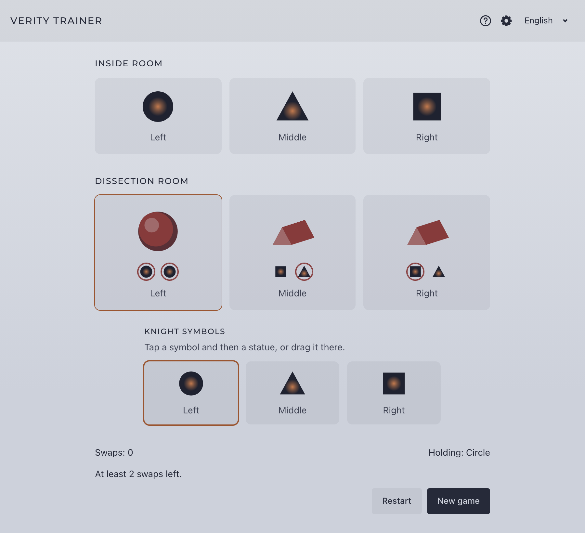

# Verity Trainer

[](https://github.com/unvoid/verity-trainer/actions/workflows/ci.yml)
[](LICENSE)

**English** · [Español](README.es.md)

A practice tool for the symbol swaps of **Verity**, the fourth encounter of the *Salvation's Edge* raid in Destiny 2.

**Live:** https://verity-trainer-eight.vercel.app/



## Features

- **Random starting points** that follow the encounter rules.
- **Recreate your run:** set the inside room callouts and the statue shapes you are seeing in game.
- **Tap or drag** symbols onto statues; fully usable with the keyboard.
- **Shortest solution:** a breadth-first search computes the minimum number of swaps and shows the optimal sequence when you finish.
- **Hints:** each statue's symbols, clashes with its callout, valid targets and the remaining minimum.
- **Usage guide** built into the app.
- **English and Spanish.**
- Challenge Mode and timed symbol rounds are implemented behind feature flags.

## Getting started

Requirements: **Node.js 26** or later and **npm 11** or later (see `.node-version`).

```sh
git clone https://github.com/unvoid/verity-trainer.git
cd verity-trainer
npm install
npm run dev
```

The project's `.npmrc` pins the public npm registry and enables `engine-strict`, so installing with an older Node version fails early.

## Scripts

| Command | Description |
|---|---|
| `npm run dev` | Start the development server |
| `npm run build` | Build for production into `dist/` |
| `npm run preview` | Serve the production build locally |
| `npm run check` | Type-check Svelte and TypeScript |
| `npm test` | Run the test suite once |
| `npm run test:watch` | Run tests in watch mode |

## Feature flags

Features can be enabled or disabled at build time through environment variables (see `.env.example`):

```sh
VITE_FEATURE_HINTS=true
VITE_FEATURE_CHALLENGE_MODE=false
VITE_FEATURE_SYMBOL_ROUNDS=false
VITE_SITE_URL=https://verity-trainer-eight.vercel.app
```

A disabled feature is hidden from the interface and listed as "coming soon" in the usage guide.

## Tech stack

- [Svelte 5](https://svelte.dev/) + TypeScript, built with [Vite](https://vite.dev/)
- [Vitest](https://vitest.dev/) for the domain logic, stores and i18n
- Shapes drawn as SVG; no 3D or UI libraries
- [Montserrat](https://fonts.google.com/specimen/Montserrat) (SIL Open Font License), self-hosted through `@fontsource-variable/montserrat`
- Static site: deploy the contents of `dist/` to any static host

## Project structure

```
src/
  lib/
    domain/       # Encounter rules, swaps, solver and scenarios (pure TypeScript)
    stores/       # Game, setup, settings, drag and toast state
    components/   # Svelte components
    i18n/         # English and Spanish texts
    theme/        # Design tokens and base styles
    visual/       # Shared SVG geometry (symbols, loader)
tests/            # Vitest suites
docs/             # Design and mechanics documentation (Spanish)
```

## Documentation

Detailed documentation lives in [`docs/`](docs/) and is written in Spanish:

- [Encounter mechanics](docs/mecanica.md)
- [Architecture](docs/arquitectura.md)
- [Visual design](docs/estetica.md)
- [Tone and vocabulary](docs/tono.md)

## Credits

- Inspired by **[Verity Simulator](https://verity.cabotmc.dev/)** by EggAllocationService ([repository](https://github.com/EggAllocationService/verity-sim)). This project is an independent implementation and does not reuse its code.
- The community "Shape Reference Guide" by Nec was used as a reference.
- Destiny 2 is a trademark of Bungie, Inc. This is an unofficial fan project, not affiliated with or endorsed by Bungie, and it uses no official assets.

## License

[MIT](LICENSE)
